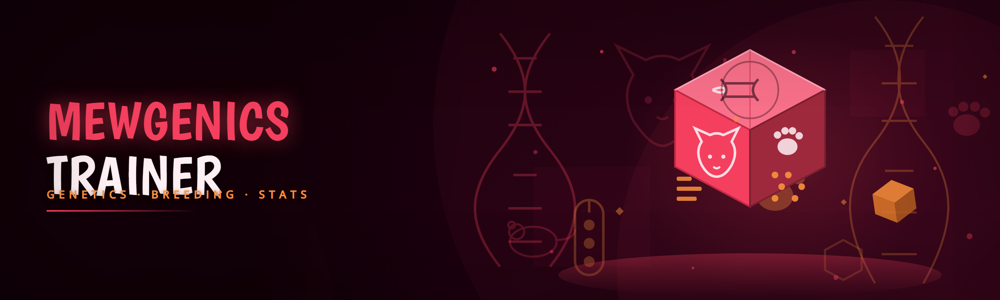

  
  
  

  

  
  

---

## 🐾 Changelog / Release History

The 2026 rewrite is not a recompile of the old 2023 byte-patched trainer — it is a full rebuild of the injection path, the tick-sync layer, and the gene editor, because Mewgenics moved off the legacy Unity MonoBehaviour loop and now drives breeding and combat through an ECS-style scheduler. Old signature scanners that hooked `Update()` are dead. This build hooks the scheduler flush instead and reads state off a stable shadow buffer.

| Version | Date | Changes |
|---|---|---|
| v2.0.0 | 2026-01-14 | Rebuilt injector around ECS flush hook; dropped legacy `Mono` detour; stable under Proton 9 / Steam Deck |
| v2.0.1 | 2026-01-28 | Fixed gene-editor write buffer overflowing at generation > 40; added `/recalc` hotkey |
| v2.0.2 | 2026-02-09 | Detection-resistance pass — randomized injection stub layout per launch, no static RWX page |
| v2.0.3 | 2026-02-22 | Save-thumbnail decryption dumper now works on encrypted cloud saves; added backup rotation |
| v2.0.4 | 2026-03-05 | Room-overlay HUD rewritten in a real overlay surface instead of stock toasts; hotkey rebinds saved to profile |
| v2.1.0 | 2026-03-19 | AI gene-forecast engine: predicts kitten stat rolls before breeding; optional LLM trait-advisor module |
| v2.1.1 | 2026-03-27 | Fixed Steam Deck touch HUD scaling; reduced ticks-sync drift under 30 fps cap |
| v2.1.2 | 2026-04-11 | Crash fix when spoofer ran before overlay init; load order is now enforced |

## 🧬 Key Features

The trainer is organised around three loops: **generate** (cats and genes), **survive** (combat and encounters), and **observe** (HUD, overlay, data dump). Every module below is toggleable at runtime through the in-game HUD or the hotkey surface. Nothing is baked into the `.exe` statically.

| Feature | Description | Benefit |
|---|---|---|
| Gene Injector | Writes a chosen allele set directly into a cat's genome buffer before the breeding scheduler consumes it | Deterministic trait targeting, no RNG roulette |
| Mutation Weight Sliders | Re-weights the mutation table per lineage instead of hard-overriding it | Keep a natural feel while steering a bloodline |
| AI Gene Forecast | Predicts kitten stat rolls and mutation odds from current genome + lineage history | Breed smart, skip dead-end litters |
| Combat State Freeze | Pauses the encounter tick loop on demand | Inspect enemy movesets and reposition |
| Enemy AI Reveal | Shows the enemy decision tree that the shell is about to pick | Learn the AI, not just beat it |
| Stat Sheet Overlay | Live overlay readout of any cat: HP, armor, movement, hidden cooldowns | Always-on HUD, dockable |
| Room Hazard Preview | Draws hazards and ambush tiles before entering a room | Plan routes instead of eating traps |
| Save Dumper / Decrypt | Dumps the encrypted save to JSON and re-encrypts cleanly after edits | Real backups, real restore |
| Lineage Visualiser | Renders the full ancestry graph, including hidden in-breds | Understand what your breeding actually did |
| Trait Compounder | Applies compound trait stacks the game only grants through rare events | Build weird lineages on purpose |
| Encounter Rate Control | Slides the shell's spawn probability density | Grind or rush, your call |

**Generation loop** — Everything that shapes a kitten before it draws its first breath lives here. The gene editor writes into a shadow buffer that is flushed into the scheduler only on my explicit `/commit` command, so bad edits never corrupt a lineage mid-run.

- **Genome Editor** — cell-by-cell allele editing with mutation and trait columns visible at once
- **Lineage Graph** — pan/zoom ancestry DAG, click any node to fork a breeding plan
- **Litter Predictor** — statistical table of expected offspring before you commit a pair
- **Trait Reroll Clock** — triggers a reroll without resetting the lineage counter

**Survival loop** — Combat, room selection, and the encounter shell. Modules here read enemy intent before the shell renders it.

- **Turn Order Inspector** — shows the exact initiative order the shell computed
- **Damage Preview** — damage roll + armor interaction before committing an attack
- **Room Cache Refresh** — forces the room cache to re-roll the current floor

**Observation loop** — HUD, overlay, dumps, and anything that writes to disk.

- **Save Thumbnail Dumper** — extracts and decrypts cloud save thumbnails for diffing
- **JSON Export** — whole-run export for offline analysis
- **Backup Rotation** — rolling backups on every `/commit`

  

## 🧠 AI Integration — what the 2026 build actually ships

The AI adder is not a wrapper around a cloud chatbot that gets called every tick. It is a local inference pass that runs once per breeding decision against the shell's own mutation table. Two modules carry the name:

- **Gene Forecast Engine** — a small local model trained on the shape of Mewgenics' own mutation distribution. It does not decide anything; it only estimates probability mass per outcome and hands the numbers to the HUD. You still press `/commit`.
- **Trait Advisor (optional)** — an opt-in module that sends a *sanitised* lineage summary (no account identifiers, no Steam ID) to a self-hosted endpoint you configure yourself. The default is disabled. If you want an LLM to argue about whether to breed the blind cat with the armored one, this is where it lives. Read the `issues` thread on privacy before enabling.

What it does **not** do: it does not aim for you, it does not play the game, and it does not make decisions. It forecasts and it advises. Everything that touches game state is deterministic code and can be reviewed.

## 🧰 All modules status

| Module | Status | Description |
|---|---|---|
| gene-injector | ✅ Working | Shadow-buffer allele write, `/commit` flush |
| mutation-weights | ✅ Working | Per-lineage mutation table re-weighting |
| trait-compounder | ✅ Working | Compound trait stacking with validation gate |
| litter-predictor | ✅ Working | Statistical offspring table pre-breed |
| lineage-graph | ✅ Working | DAG renderer with fork-plan mode |
| reroll-clock | ✅ Working | Trait reroll without lineage reset |
| combat-freeze | ✅ Working | Encounter tick-loop pause |
| enemy-ai-reveal | ✅ Working | Intent tree display |
| turn-order | ✅ Working | Initiative order readout |
| damage-preview | ✅ Working | Pre-commit damage math |
| stat-sheet | ✅ Working | Dockable live-stat overlay |
| room-hazards | ✅ Working | Hazard + ambush tile draw |
| room-cache-refresh | ✅ Working | Floor re-roll |
| encounter-rate | ✅ Working | Spawn density slider |
| save-dumper | ✅ Working | JSON export w/ re-encrypt |
| save-thumbnail | ✅ Working | Cloud save thumbnail decrypt |
| backup-rotation | ✅ Working | Rolling backups on commit |
| ai-forecast | ✅ Working | Local mutation probability model |
| trait-advisor | ⚠️ Experimental | Opt-in, self-hosted endpoint, sanitised payload |
| steamdeck-touch-hud | ✅ Working | Proton 9 / gamepad HUD |
| spoofer | ⚠️ Experimental | ROM-ID spoofer for session isolation on shared hardware |
| recalc-hook | ✅ Working | `/recalc` force re-read of state buffer |
| profile-hotkeys | ✅ Working | Rebinds saved per profile |

## 📖 What is Mewgenics Trainer — glossary

New here? The vocabulary inside the trainer bubbles up from the Mewgenics modding scene, and it is worth knowing before you touch a `.exe` from a stranger.

| Term | Explanation |
|---|---|
| Injector | The component that loads the trainer into the running game process. Hooks the ECS flush, not the render loop |
| Shadow buffer | A copy of game state that the trainer edits before committing to the real scheduler buffer |
| Tick-sync | The layer that keeps the trainer's edits aligned with the game's fixed-timestep scheduler |
| Genome | A cat's allele table — governing everything from fur to hidden combat traits |
| Lineage | The ancestry graph of a bloodline; the trainer visualises it as a DAG |
| Mutation table | The shell's probability distribution over mutation outcomes |
| HUD overlay | The dockable surface drawing live stats on top of the game |
| Commit | The act of flushing shadow-buffer edits into the live scheduler |

- No game file patching — the trainer never modifies the installation directory
- Reversible — every commit snapshots the previous state into the backup rotation
- Configurable — hotkeys and module toggles saved per profile
- Transparent — status rows above are honest, not aspirational

## 💡 Tips for best results

- Run the trainer **before** launching the game so the injector can bind before the scheduler spawns its first tick — the load order is enforced as of v2.1.2.
- On Steam Deck, launch the trainer with Proton 9 and keep the touch HUD on; the overlay surface does not scale well below 720p.
- Use the backup rotation *religiously* if you are editing genomes. A bad cell write is recoverable from last commit; a corrupt lineage is not.
- `Trait Advisor` requires a self-hosted endpoint. If you don't have one, leave it off — it will just fail closed.
- Expect `spoofer` to be flaky on shared hardware. It is honestly labelled experimental for a reason; read the open issues before you file a new one.
- `/recalc` forces the trainer to re-read the state buffer. Useful after an in-game reload.

## 🗺️ Roadmap / Planned features

| Feature | Status | ETA |
|---|---|---|
| Deterministic litter editor (edit *offspring* before birth) | 🟡 In progress | Q2 2026 |
| `Godmode` combat toggle (freeze enemy damage, not the whole tick loop) | 🟡 In progress | Q2 2026 |
| Linux native injector (skip Proton) | 🔵 Planned | Q3 2026 |
| Wabbajack-style mod-loader integration | 🔵 Planned | Q3 2026 |
| `Trait Advisor` local small model (no endpoint at all) | 🔵 Planned | Q4 2026 |
| Full save-version migration tool | 🟠 Researching | TBD |
| Community gene-seed exchange format | 🟠 Researching | TBD |
| macOS build | 🔴 Not planned | — |

## ⚖️ Comparison

| Aspect | DIY Cheat Engine table | This tool |
|---|---|---|
| Injection method | RWX page write, easily scanned | Scheduler flush hook, per-launch randomised stub |
| Persistence | Manual addresses, break on every patch | Signatures rebuilt per release |
| Gene editing | Raw memory writes | Shadow buffer + commit + backups |
| HUD | None — tab out | Dockable overlay surface |
| Encounter features | Damage only | Hazards, ambush, intent preview |
| Steam Deck | Works accidentally | Proton-tested |
| Recoverability | None | Rolling backup rotation |
| Maintenance | Single contributor, dormant | Maintained, issues triaged |

## 🖥️ Overview

| Category | Details |
|---|---|
| Type | Windows desktop injector + overlay (` .exe`) |
| Target game | Mewgenics (Steam, 2026 shell) |
| Runtime | .NET 8 self-contained, no runtime install needed |
| CoE | Trainer-side only — game files untouched |
| VAC / anti-cheat | Session-based; single-player only |
| Distribution | GitHub release + landing page download |
| Licence | MIT |

The trainer operates entirely outside the game installation directory. It attaches to the running process, hooks the scheduler flush, and provides an overlay HUD that lives to the right of the Mewgenics window. Every edit that touches game state is routed through a commit gate; nothing is written outside that gate. That design choice is why gene edits are safe and why a bad module can't corrupt a lineage.

## 🚀 Quick Start

1. 🧾 Head to the project page from the download block on this page and grab the 2026 build.
2. 📦 Extract the archive to a folder you own — not `Program Files`, not a synced drive.
3. 🖱️ Right-click the `.exe` → **Run as administrator** (the injector needs to open the target process handle on Windows 10/11 without UAC prompt-storming).
4. 🎮 Launch Mewgenics from Steam (or from the trainer's "launch game" button if you keep it on a non-default library path).
5. 🎛️ Alt-tab to the overlay, open the module panel, and toggle what you need. The hotkey table below is your map.

## ⌨️ Hotkeys / keybind table

All binds are editable in the profile panel and saved per Windows user.

| Action | Default bind |
|---|---|
| Open module panel | `F8` |
| Toggle stat-sheet overlay | `F9` |
| Commit gene edits | `/commit` (chat-style input in panel) |
| Force state re-read | `/recalc` |
| Freeze combat tick | `F10` |
| Reveal enemy intent | `Shift + F10` |
| Cycle room hazard layer | `F11` |
| Panic-hide overlay | `Ctrl + Shift + H` |

## 🎮 Compatibility

- 🎮 Steam (Windows 10 / 11) — supported, tested against the 2026 shell
- 🕹️ Steam Deck (Proton 9) — supported, touch HUD auto-enables
- 💬 Discord overlay — disabled automatically if the trainer overlay is active, to avoid double-attach
- 🐧 Linux desktop — not supported yet, see roadmap
- 🍎 macOS — not planned
- 🖥️ Windows 8.1 and below — not supported (needs .NET 8)

## 📦 Installation

**1. Download.** Use the `[DOWNLOAD]` block only — no other source is the 2026 build.

**2. Extract.** Put the extracted folder somewhere stable. Do not extract inside Steam's `common/Mewgenics` directory. The trainer loads the game mod directory from Steam's registry keys, not from proximity.

**3. First run.** Launch the `.exe` as administrator. It will create its own `%LOCALAPPDATA%\MewgenicsTrainer\` profile folder, ask you once to confirm your Steam library path, and then attempt to bind to the scheduler on next game launch. If bind fails, the panel shows the exact last error — copy it into an issue.

## 🧩 Known Issues

| Issue | Solution |
|---|---|
| Bind never completes even after game launch | Ensure trainer is elevated; some AV solutions block `OpenProcess` silently |
| Overlay invisible on Steam Deck | Toggle touch HUD in profile; lower resolution to 1280×800 |
| Gene edits do not appear in later litters | You edited the shadow buffer but did not `/commit` |
| Trait Advisor fails closed on first toggle | It needs a self-hosted endpoint in profile; leave it off if you don't have one |
| Spoofer sometimes no-ops | Honest limitation — see issues; skip on shared hardware |
| `/recalc` crashes on old saves | Update to v2.0.4+, migration done |

## 🐛 FAQ

| Question | Answer |
|---|---|
| Will I get banned from Steam? | Mewgenics is single-player. The trainer does not touch online services or Steam auth. Use is at your own risk, per the usual modding etiquette. |
| Does this modify my game files? | No. The trainer never writes to the installation directory. It edits the running process and writes backups to its own profile folder. |
| Why build a trainer in 2026 when there are CE tables? | CE tables break every patch. The trainer rebuilds its signatures per release and provides commit-gated gene editing that raw memory writes cannot. |
| Is the spoofer ready? | No — it is honestly labelled experimental. It exists to isolate sessions on shared hardware, it is not a full anti-cheat bypass, and the issues thread describes exactly where it falls over. |
| Can I get the trainer on my Steam Deck? | Yes, via Proton 9. Launch the trainer inside the same Proton prefix as Mewgenics. The touch HUD auto-enables. |
| Why is the AI integration opt-in? | Because sending lineage data anywhere, even sanitised, should be a conscious choice. Forecast engine is local; Trait Advisor is off by default. |
| Where do I report a bug? | Open an issue on the repo with the exact last-error string the panel shows. Repros with a save dump attached get triaged first. |
| Does it work with mod loader X? | If you mean the Wabbajack-style loader, not yet — roadmap item. Vanilla Mewgenics is the only supported target in 2026. |
| What if I corrupt a lineage? | Restore from the most recent commit in your backup rotation, then `/recalc`. If you never committed, the game's own autosave is your fallback. |
| Is this open source? | Yes — MIT, trainer code only. Game assets are not redistributed. |

## 💰 Licence & honesty

MIT licence for the trainer source. The `.exe` is the 2026 build of that source; no compiled shim, no hidden payload. If you want to verify, read the source and diff against the release. Community mod tools live and die on whether the maintainer is honest about status — that is what the ✅/⚠️/🟡/🔵/🟠/🔴 icons are for. If a row says experimental, believe it. Bug reports go to the issues tab; issues with a save dump and the panel's error string get picked up first.

The 2026 rebuild exists because Mewgenics changed under us and the old trainer stopped working. I rebuilt it, documented everything I reverse-engineered along the way, and open-sourced the whole thing. If you find the trainer useful, the best thing you can do is file a good issue — that's worth more than any star.

  

